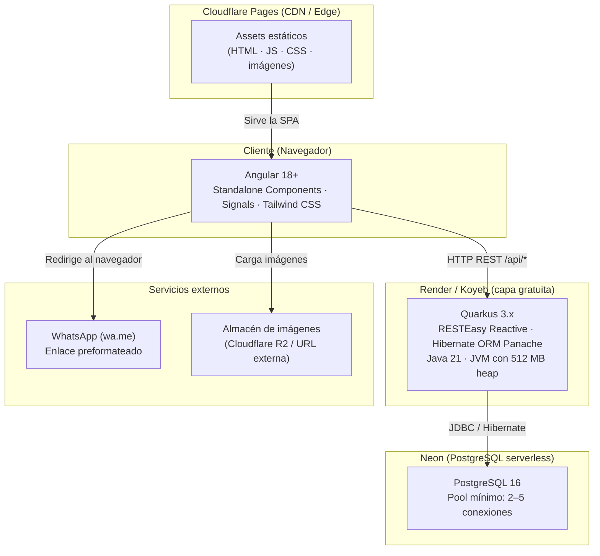
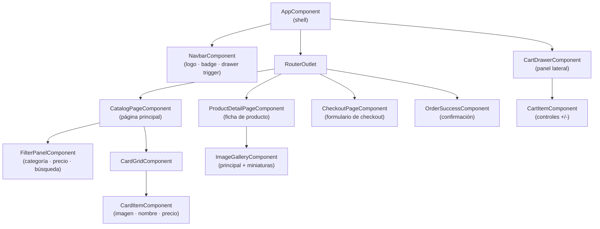
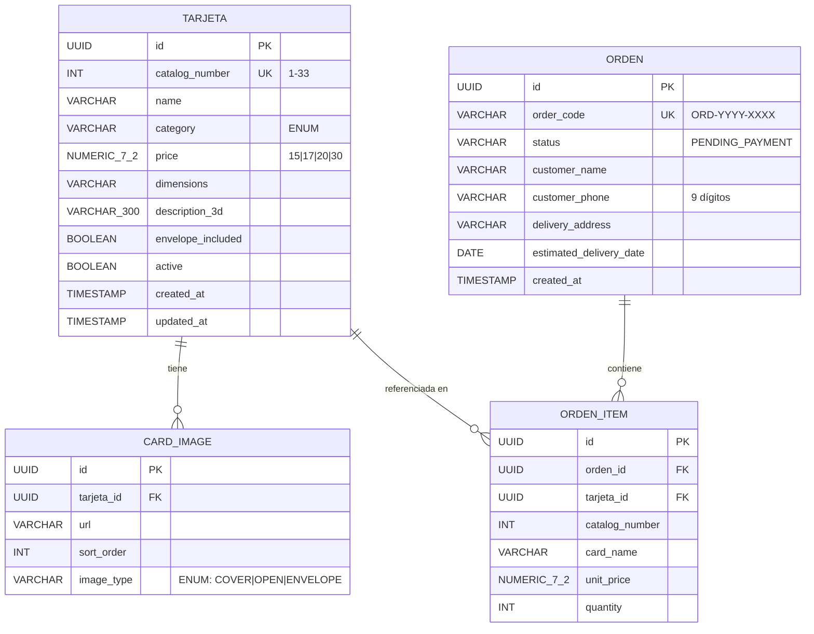

# Documento de Diseño: Hora Azul E-Commerce

## Overview

Hora Azul E-Commerce es una plataforma de venta en línea para tarjetas pop-up 3D artesanales con corte láser. El MVP permite al cliente explorar el catálogo de 33 tarjetas, filtrar por categoría y precio, gestionar un carrito de compras y cerrar la venta a través de WhatsApp con un enlace `wa.me` preformateado. El pago se coordina fuera de la plataforma; no existe pasarela de pago integrada en esta fase.

La plataforma se despliega en su totalidad en capas gratuitas: Cloudflare Pages (frontend), Render o Koyeb (backend) y Neon (base de datos PostgreSQL), priorizando bajo consumo de recursos y tiempos de cold-start aceptables.

---

## Architecture

### Diagrama de capas



### Flujo de despliegue

```
1. Push a rama main
        │
        ├─► Cloudflare Pages: ng build --configuration production
        │   └─ Archivos estáticos publicados en CDN global
        │
        └─► Render / Koyeb: mvn package -Pnative  (o JVM mode)
            └─ Contenedor desplegado con variables de entorno:
               QUARKUS_DATASOURCE_JDBC_URL  → Neon connection string
               QUARKUS_HTTP_PORT            → 8080
               JAVA_OPTS                   → -Xmx512m -Xms128m
```

### Consideraciones de cold start

Render y Koyeb en capa gratuita pueden "dormir" la instancia tras un período de inactividad. Para mitigar la latencia del primer usuario real del día, el `AppComponent` Angular emite una solicitud `GET /q/health` en segundo plano al iniciar la aplicación (keep-alive pasivo). El requisito 8.2 establece un máximo de 30 segundos para la respuesta al primer request.

---

## Components and Interfaces

### Diagrama de componentes Angular



### Componentes (Standalone Components)

| Componente | Responsabilidad |
|---|---|
| `AppComponent` | Shell de la aplicación: navbar, router-outlet, cart drawer |
| `NavbarComponent` | Logo, badge del carrito (computed signal), botón abrir drawer |
| `CatalogPageComponent` | Página principal: orquesta filtros y cuadrícula |
| `FilterPanelComponent` | Filtros por categoría (checkboxes), precio (radio), búsqueda texto, botón limpiar |
| `CardGridComponent` | Grid responsivo (2 cols ≤768px / 4 cols ≥1024px) de `CardItemComponent` |
| `CardItemComponent` | Tarjeta individual: imagen, nombre, categoría, precio formateado |
| `ProductDetailPageComponent` | Ficha completa: galería, datos técnicos, stock, botón agregar |
| `ImageGalleryComponent` | Imagen activa grande + miniaturas clicables |
| `CartDrawerComponent` | Panel lateral: lista de ítems, subtotales, total, botón checkout |
| `CartItemComponent` | Ítem del carrito: nombre, precio, controles +/-, eliminar |
| `CheckoutPageComponent` | Formulario Reactive Forms: nombre, teléfono, dirección, fecha entrega |
| `OrderSuccessComponent` | Pantalla de confirmación: código ORD-YYYY-XXXX, instrucciones WhatsApp |

### Servicios Angular

| Servicio | Responsabilidad |
|---|---|
| `CardService` | Llamadas HTTP al backend `/api/cards`, caché en memoria 5 min con Signal |
| `CartService` | Estado del carrito con `signal()` + `computed()`, persistencia `localStorage` |
| `OrderService` | `POST /api/orders` al backend, manejo de errores |
| `WhatsAppService` | Construcción del enlace `wa.me` con mensaje preformateado |

### Rutas Angular

```typescript
export const routes: Routes = [
  { path: '',        loadComponent: () => import('./catalog/catalog-page.component') },
  { path: 'tarjeta/:id', loadComponent: () => import('./detail/product-detail-page.component') },
  { path: 'checkout',    loadComponent: () => import('./checkout/checkout-page.component') },
  { path: 'pedido/:orderCode', loadComponent: () => import('./success/order-success.component') },
  { path: '**', redirectTo: '' }
];
```

Todas las rutas usan lazy loading para optimizar el bundle inicial.

---

## Data Models

### Esquema relacional PostgreSQL



### DDL simplificado

```sql
-- Enums
CREATE TYPE card_category AS ENUM (
    'CUMPLEANOS', 'FLORES', 'AMOR',
    'SIN_MENSAJE', 'MEJORES_DESEOS', 'AGRADECIMIENTO'
);
CREATE TYPE image_type AS ENUM ('COVER', 'OPEN', 'ENVELOPE');
CREATE TYPE order_status AS ENUM ('PENDING_PAYMENT');

-- Tarjeta
CREATE TABLE tarjeta (
    id               UUID PRIMARY KEY DEFAULT gen_random_uuid(),
    catalog_number   INT NOT NULL UNIQUE CHECK (catalog_number BETWEEN 1 AND 33),
    name             VARCHAR(150) NOT NULL,
    category         card_category NOT NULL,
    price            NUMERIC(7,2) NOT NULL CHECK (price IN (15.00, 17.00, 20.00, 30.00)),
    dimensions       VARCHAR(50),
    description_3d   VARCHAR(300),
    envelope_included BOOLEAN NOT NULL DEFAULT TRUE,
    active           BOOLEAN NOT NULL DEFAULT TRUE,
    created_at       TIMESTAMP NOT NULL DEFAULT now(),
    updated_at       TIMESTAMP NOT NULL DEFAULT now()
);

-- Imágenes de tarjeta
CREATE TABLE card_image (
    id          UUID PRIMARY KEY DEFAULT gen_random_uuid(),
    tarjeta_id  UUID NOT NULL REFERENCES tarjeta(id),
    url         VARCHAR(500) NOT NULL,
    sort_order  INT NOT NULL DEFAULT 0,
    image_type  image_type NOT NULL
);

-- Secuencia de orden por año (se reinicia cada año lógicamente mediante el código)
CREATE SEQUENCE orden_seq START 1;

-- Orden
CREATE TABLE orden (
    id                      UUID PRIMARY KEY DEFAULT gen_random_uuid(),
    order_code              VARCHAR(20) NOT NULL UNIQUE,  -- ORD-YYYY-XXXX
    status                  order_status NOT NULL DEFAULT 'PENDING_PAYMENT',
    customer_name           VARCHAR(100) NOT NULL,
    customer_phone          CHAR(9) NOT NULL,
    delivery_address        VARCHAR(200) NOT NULL,
    estimated_delivery_date DATE NOT NULL,
    created_at              TIMESTAMP NOT NULL DEFAULT now()
);

-- Ítems de orden
CREATE TABLE orden_item (
    id             UUID PRIMARY KEY DEFAULT gen_random_uuid(),
    orden_id       UUID NOT NULL REFERENCES orden(id),
    tarjeta_id     UUID REFERENCES tarjeta(id),
    catalog_number INT NOT NULL,
    card_name      VARCHAR(150) NOT NULL,
    unit_price     NUMERIC(7,2) NOT NULL,
    quantity       INT NOT NULL CHECK (quantity BETWEEN 1 AND 99)
);
```

### Generación del código ORD-YYYY-XXXX

El backend genera el código de la siguiente manera: obtiene el máximo número secuencial de las órdenes del año en curso consultando `MAX(order_code)` filtrado por el prefijo `ORD-{YYYY}-`, incrementa en 1 y formatea con `String.format("ORD-%d-%04d", year, nextSeq)`. La operación se ejecuta dentro de una transacción con nivel `SERIALIZABLE` para garantizar unicidad bajo concurrencia.

### Entidades Hibernate Panache (Java)

```java
@Entity
@Table(name = "tarjeta")
public class Tarjeta extends PanacheEntityBase {
    @Id @GeneratedValue(strategy = GenerationType.UUID)
    public UUID id;

    @Column(name = "catalog_number", unique = true, nullable = false)
    public Integer catalogNumber;

    @Column(nullable = false, length = 150)
    public String name;

    @Enumerated(EnumType.STRING)
    @Column(nullable = false)
    public CardCategory category;

    @Column(nullable = false, precision = 7, scale = 2)
    public BigDecimal price;

    @Column(length = 50)
    public String dimensions;

    @Column(name = "description_3d", length = 300)
    public String description3d;

    @Column(name = "envelope_included", nullable = false)
    public Boolean envelopeIncluded = true;

    @Column(nullable = false)
    public Boolean active = true;

    @OneToMany(mappedBy = "tarjeta", cascade = CascadeType.ALL, fetch = FetchType.LAZY)
    public List<CardImage> images = new ArrayList<>();
}
```

---

## Contratos REST / OpenAPI

### Base URL: `/api`

---

#### `GET /api/cards`

Retorna las tarjetas activas. Soporta filtros opcionales por categoría y precio.

**Query parameters**

| Parámetro | Tipo | Descripción |
|---|---|---|
| `category` | `string` | Categoría exacta (p. ej. `FLORES`) |
| `minPrice` | `number` | Precio mínimo inclusivo |
| `maxPrice` | `number` | Precio máximo inclusivo |
| `page` | `int` | Página (0-indexed, default 0) |
| `size` | `int` | Tamaño de página (default 100, máx 100) |

**Response `200 OK`**

```json
{
  "content": [
    {
      "id": "550e8400-e29b-41d4-a716-446655440000",
      "catalogNumber": 7,
      "name": "Rosa Eterna",
      "category": "FLORES",
      "price": 17.00,
      "dimensions": "15×10 cm",
      "description3d": "Rosa pop-up de tres niveles con efecto de profundidad.",
      "envelopeIncluded": true,
      "coverImageUrl": "https://cdn.example.com/card-7-cover.jpg"
    }
  ],
  "totalElements": 33,
  "totalPages": 1,
  "page": 0,
  "size": 100
}
```

**Códigos de estado:** `200 OK` · `400 Bad Request` (parámetros inválidos)

---

#### `GET /api/cards/{id}`

Retorna el detalle completo de una tarjeta por su UUID (incluyendo inactivas).

**Response `200 OK`**

```json
{
  "id": "550e8400-e29b-41d4-a716-446655440000",
  "catalogNumber": 7,
  "name": "Rosa Eterna",
  "category": "FLORES",
  "price": 17.00,
  "dimensions": "15×10 cm",
  "description3d": "Rosa pop-up de tres niveles con efecto de profundidad.",
  "envelopeIncluded": true,
  "active": true,
  "images": [
    { "url": "https://cdn.example.com/card-7-cover.jpg", "imageType": "COVER", "sortOrder": 0 },
    { "url": "https://cdn.example.com/card-7-open.jpg",  "imageType": "OPEN",  "sortOrder": 1 },
    { "url": "https://cdn.example.com/card-7-env.jpg",   "imageType": "ENVELOPE", "sortOrder": 2 }
  ],
  "createdAt": "2025-01-15T10:30:00Z",
  "updatedAt": "2025-06-01T08:00:00Z"
}
```

**Códigos de estado:** `200 OK` · `404 Not Found`

---

#### `POST /api/cards` *(requiere auth Admin)*

Crea una nueva tarjeta.

**Request body**

```json
{
  "catalogNumber": 34,
  "name": "Mariposa Azul",
  "category": "AMOR",
  "price": 20.00,
  "dimensions": "14×9 cm",
  "description3d": "Mariposa pop-up con alas articuladas de dos capas.",
  "envelopeIncluded": true,
  "images": [
    { "url": "https://cdn.example.com/card-34-cover.jpg", "imageType": "COVER", "sortOrder": 0 }
  ]
}
```

**Response `201 Created`**: objeto `CardDetailResponse` completo.

**Códigos de estado:** `201 Created` · `401 Unauthorized` · `409 Conflict` (catalog_number duplicado) · `422 Unprocessable Entity` (precio inválido, campos faltantes)

---

#### `PUT /api/cards/{id}` *(requiere auth Admin)*

Actualiza los atributos modificables de una tarjeta. El `catalogNumber` es inmutable.

**Request body**: mismos campos que `POST /api/cards` exceptuando `catalogNumber`.

**Response `200 OK`**: objeto `CardDetailResponse` actualizado.

**Códigos de estado:** `200 OK` · `401 Unauthorized` · `404 Not Found` · `422 Unprocessable Entity`

---

#### `PATCH /api/cards/{id}/deactivate` *(requiere auth Admin)*

Baja lógica: marca la tarjeta como inactiva sin eliminarla.

**Response `200 OK`**

```json
{ "id": "550e8400-...", "active": false, "message": "Tarjeta desactivada exitosamente." }
```

**Códigos de estado:** `200 OK` · `401 Unauthorized` · `404 Not Found`

---

#### `POST /api/orders`

Crea una nueva orden a partir del checkout del cliente.

**Request body**

```json
{
  "customerName": "María García",
  "customerPhone": "987654321",
  "deliveryAddress": "Av. Larco 1234, Miraflores, Lima",
  "estimatedDeliveryDate": "2025-12-20",
  "items": [
    { "tarjetaId": "550e8400-e29b-41d4-a716-446655440000", "quantity": 2 },
    { "tarjetaId": "660e8400-e29b-41d4-a716-446655441111", "quantity": 1 }
  ]
}
```

**Response `201 Created`**

```json
{
  "orderCode": "ORD-2025-0001",
  "status": "PENDING_PAYMENT",
  "customerName": "María García",
  "totalAmount": 51.00,
  "items": [
    { "catalogNumber": 7, "cardName": "Rosa Eterna", "unitPrice": 17.00, "quantity": 2, "subtotal": 34.00 },
    { "catalogNumber": 12, "cardName": "Mariposa Azul", "unitPrice": 17.00, "quantity": 1, "subtotal": 17.00 }
  ],
  "createdAt": "2025-12-15T14:30:00Z"
}
```

**Códigos de estado:** `201 Created` · `400 Bad Request` (carrito vacío) · `422 Unprocessable Entity` (validación fallida)

---

#### `GET /api/orders` *(requiere auth Admin)*

Retorna todas las órdenes ordenadas por fecha de creación descendente.

**Response `200 OK`**: array de resúmenes de orden con `orderCode`, `customerName`, `totalAmount`, `status`, `createdAt`.

**Códigos de estado:** `200 OK` · `401 Unauthorized`

---

#### `GET /api/orders/{orderCode}` *(requiere auth Admin)*

Retorna el detalle completo de una orden por su código `ORD-YYYY-XXXX`.

**Códigos de estado:** `200 OK` · `401 Unauthorized` · `404 Not Found`

---

#### `GET /q/health`

Health check nativo de Quarkus SmallRye Health.

**Response `200 OK`**

```json
{ "status": "UP", "checks": [{ "name": "Database connections", "status": "UP" }] }
```

---

## Gestión de Estado con Angular Signals

El `CartService` es la pieza central del estado del frontend. Usa `signal()` para el estado mutable y `computed()` para las derivaciones:

```typescript
@Injectable({ providedIn: 'root' })
export class CartService {
  // Estado mutable del carrito
  private readonly _items = signal<CartItem[]>([]);

  // Derivaciones automáticas (recalculan solo cuando _items cambia)
  readonly items = this._items.asReadonly();

  readonly totalItems = computed(() =>
    this._items().reduce((sum, item) => sum + item.quantity, 0)
  );

  readonly totalAmount = computed(() =>
    this._items().reduce((sum, item) => sum + item.unitPrice * item.quantity, 0)
  );

  readonly isEmpty = computed(() => this._items().length === 0);

  addItem(tarjeta: CardDetail): void {
    const current = this._items();
    const existing = current.find(i => i.tarjetaId === tarjeta.id);

    if (existing) {
      if (existing.quantity >= 99) {
        // Notificar al usuario — límite alcanzado
        return;
      }
      this._items.update(items =>
        items.map(i => i.tarjetaId === tarjeta.id
          ? { ...i, quantity: i.quantity + 1 }
          : i
        )
      );
    } else {
      this._items.update(items => [...items, {
        tarjetaId: tarjeta.id,
        catalogNumber: tarjeta.catalogNumber,
        cardName: tarjeta.name,
        unitPrice: tarjeta.price,
        quantity: 1
      }]);
    }
    this.persist();
  }

  removeItem(tarjetaId: string): void {
    this._items.update(items => items.filter(i => i.tarjetaId !== tarjetaId));
    this.persist();
  }

  updateQuantity(tarjetaId: string, quantity: number): void {
    if (quantity <= 0) {
      this.removeItem(tarjetaId);
      return;
    }
    this._items.update(items =>
      items.map(i => i.tarjetaId === tarjetaId
        ? { ...i, quantity: Math.min(quantity, 99) }
        : i
      )
    );
    this.persist();
  }

  clearCart(): void {
    this._items.set([]);
    localStorage.removeItem('hora_azul_cart');
  }

  private persist(): void {
    try {
      localStorage.setItem('hora_azul_cart', JSON.stringify(this._items()));
    } catch {
      // localStorage no disponible — mantener en memoria
    }
  }

  loadFromStorage(): void {
    try {
      const raw = localStorage.getItem('hora_azul_cart');
      if (raw) this._items.set(JSON.parse(raw));
    } catch {
      this._items.set([]);
    }
  }
}
```

El `NavbarComponent` consume `cartService.totalItems` directamente en la plantilla como signal:

```html
@if (cartService.totalItems() > 0) {
  <span class="badge">{{ cartService.totalItems() }}</span>
}
```

---

## Optimización para Capa Gratuita

### Quarkus (Render / Koyeb)

```properties
# application.properties

# JVM heap limitado a 512 MB
quarkus.jvm.args=-Xmx512m -Xms128m

# Hibernate: actualiza esquema sin recrear tablas
quarkus.hibernate-orm.database.generation=update

# Pool de conexiones mínimo para Neon (serverless)
quarkus.datasource.jdbc.min-size=2
quarkus.datasource.jdbc.max-size=5
quarkus.datasource.jdbc.acquisition-timeout=10s

# CORS para Cloudflare Pages
quarkus.http.cors=true
quarkus.http.cors.origins=https://hora-azul.pages.dev

# Compresión de respuestas HTTP
quarkus.http.enable-compression=true

# Health checks
quarkus.smallrye-health.ui.enable=false
```

### Angular (Cloudflare Pages)

- **Lazy loading** en todas las rutas (ver sección de rutas).
- **Caché en `CardService`**: `signal<CardCacheEntry | null>()` que almacena la lista y un timestamp. Si `now - cachedAt < 5min`, retorna el caché sin HTTP.
- **Keep-alive silencioso**: el `AppComponent` llama `GET /q/health` en `ngOnInit` para despertar el backend antes de que el usuario lo necesite.
- **Prefetch desactivado** en `_headers` de Cloudflare para evitar solicitudes innecesarias.

```typescript
// card.service.ts — caché en memoria
private readonly _cache = signal<{ data: CardSummary[]; cachedAt: number } | null>(null);
private readonly CACHE_TTL = 5 * 60 * 1000; // 5 minutos

getCards(filters?: CardFilters): Observable<CardSummary[]> {
  const cache = this._cache();
  if (cache && (Date.now() - cache.cachedAt) < this.CACHE_TTL) {
    return of(cache.data);
  }
  return this.http.get<CardListResponse>('/api/cards', { params: filters as any }).pipe(
    tap(res => this._cache.set({ data: res.content, cachedAt: Date.now() })),
    map(res => res.content)
  );
}
```

---

## Correctness Properties

*Una propiedad es una característica o comportamiento que debe ser verdadera en todas las ejecuciones válidas del sistema — esencialmente, un enunciado formal sobre lo que el sistema debe hacer. Las propiedades sirven de puente entre las especificaciones legibles por humanos y las garantías de corrección verificables por máquina.*

### Property 1: Integridad aritmética del carrito

*Para cualquier* estado del carrito (cualquier número de ítems, precios y cantidades válidos), el subtotal de cada ítem debe ser exactamente `precio_unitario × cantidad`, y el total del carrito debe ser exactamente la suma de todos los subtotales.

**Validates: Requirements 4.2, 4.3, 4.4**

### Property 2: Unicidad de código de orden por año

*Para cualquier* par de órdenes creadas en el mismo año calendario, sus códigos `ORD-YYYY-XXXX` deben ser distintos entre sí.

**Validates: Requirements 5.7**

### Property 3: Rechazo de precios inválidos

*Para cualquier* valor de precio que no pertenezca al conjunto `{15.00, 17.00, 20.00, 30.00}`, el sistema debe rechazar la solicitud de creación o actualización de tarjeta con HTTP 422.

**Validates: Requirements 6.7**

### Property 4: Round-trip de persistencia del carrito

*Para cualquier* estado del carrito (colección arbitraria de ítems con precios, cantidades y nombres), serializar el estado a `localStorage` y luego deserializarlo debe producir un objeto estructuralmente idéntico al original.

**Validates: Requirements 4.7**

### Property 5: Corrección del filtrado del catálogo

*Para cualquier* combinación de filtros activos (categoría, rango de precio, texto de búsqueda) y *para cualquier* lista de tarjetas, el resultado del filtrado no debe contener ninguna tarjeta que incumpla al menos uno de los criterios activos.

**Validates: Requirements 2.3, 2.4, 2.7**

### Property 6: Invariante de eliminación por cantidad cero

*Para cualquier* ítem del carrito con cantidad 1, aplicar la operación de decremento debe resultar en la eliminación del ítem del carrito (la cantidad nunca debe quedar en 0 ni en negativo).

**Validates: Requirements 4.5**

### Property 7: Unicidad del número de catálogo

*Para cualquier* tarjeta existente en la base de datos con un `catalog_number` N, intentar crear una segunda tarjeta con el mismo `catalog_number` N debe ser rechazado con HTTP 409.

**Validates: Requirements 6.6**

---

## Error Handling

### Frontend (Angular)

| Situación | Comportamiento |
|---|---|
| `GET /api/cards` falla | Mostrar mensaje de error + botón "Reintentar" |
| Lista de tarjetas vacía | Mostrar mensaje "No hay tarjetas disponibles" |
| `GET /api/cards/{id}` 404 | Navegar a página de error con enlace al catálogo |
| `POST /api/orders` falla | Mostrar mensaje descriptivo, mantener formulario con datos |
| `localStorage` no disponible | Mantener carrito en memoria, avisar al usuario |
| Carrito con cantidad máxima (99) | Rechazar adición con mensaje al usuario |

### Backend (Quarkus)

Los errores de validación y negocio se manejan mediante `ExceptionMapper` de JAX-RS. Todos los errores retornan un cuerpo JSON homogéneo:

```json
{
  "status": 422,
  "error": "INVALID_PRICE",
  "message": "El precio debe ser uno de los valores permitidos: S/. 15.00, S/. 17.00, S/. 20.00, S/. 30.00.",
  "timestamp": "2025-12-15T14:30:00Z"
}
```

| Código HTTP | Situación |
|---|---|
| `400 Bad Request` | Formato JSON inválido o parámetros malformados |
| `401 Unauthorized` | Credenciales de administrador ausentes o inválidas |
| `404 Not Found` | Tarjeta u orden no encontrada |
| `409 Conflict` | Número de catálogo duplicado |
| `422 Unprocessable Entity` | Precio inválido, campos obligatorios faltantes, validación de negocio |
| `500 Internal Server Error` | Error inesperado (logeado internamente, no expuesto al cliente) |

---

## Testing Strategy

### Testing unitario (Angular — Jest)

- **`CartService`**: verificar operaciones add/remove/update con ejemplos concretos, manejo de límite 99, persistencia en localStorage mock.
- **`FilterPanelComponent`**: verificar que el evento de cambio de filtros emite correctamente.
- **`WhatsAppService`**: verificar que el enlace `wa.me` generado contiene el código de orden, nombres de tarjetas y monto.
- **`CheckoutPageComponent`**: verificar validaciones de formulario (teléfono de 9 dígitos, fecha futura, campos obligatorios).
- Los tests unitarios se centran en ejemplos concretos y casos de borde.

### Testing unitario (Quarkus — JUnit 5 + Mockito)

- **`OrderService`**: verificar la lógica de generación del código ORD-YYYY-XXXX con año mock.
- **`TarjetaResource`**: verificar mapeo de requests/responses con `@QuarkusTest`.
- **`TarjetaRepository`**: verificar consultas de filtrado por categoría y precio.

### Testing de propiedades (Property-Based Testing)

**Framework para backend (Java/Quarkus): [jqwik](https://jqwik.net/)**  
**Framework para frontend (Angular): [fast-check](https://fast-check.io/) + Jest**

Cada test de propiedad se ejecuta con un mínimo de 100 iteraciones. Cada test debe incluir un comentario de trazabilidad con el formato:

`// Feature: hora-azul-ecommerce, Propiedad {N}: {texto de la propiedad}`

| Propiedad | Framework | Módulo a testear |
|---|---|---|
| P1 — Integridad aritmética del carrito | fast-check + Jest | `CartService` |
| P2 — Unicidad de código de orden | jqwik | `OrderCodeGenerator` |
| P3 — Rechazo de precios inválidos | jqwik | `TarjetaValidator` / `TarjetaResource` |
| P4 — Round-trip localStorage | fast-check + Jest | `CartService.persist()` + `loadFromStorage()` |
| P5 — Corrección del filtrado | fast-check + Jest | función de filtro en `CatalogPageComponent` |
| P6 — Eliminación por cantidad cero | fast-check + Jest | `CartService.updateQuantity()` |
| P7 — Unicidad de número de catálogo | jqwik | `TarjetaRepository` |

### Testing de integración

- **API + Base de datos**: con `@QuarkusTest` y base de datos H2 en modo PostgreSQL compatible (o Testcontainers con PostgreSQL real).
- **Cold start**: verificar que `GET /q/health` responde en menos de 30 segundos tras un período de inactividad.
- **Filtros combinados**: verificar que el endpoint `GET /api/cards?category=FLORES&maxPrice=20` retorna correctamente (1-3 ejemplos representativos).

### Testing E2E (Playwright — opcional post-MVP)

- Flujo completo: abrir catálogo → filtrar → ver detalle → agregar al carrito → checkout → verificar código de orden y apertura de WhatsApp.
