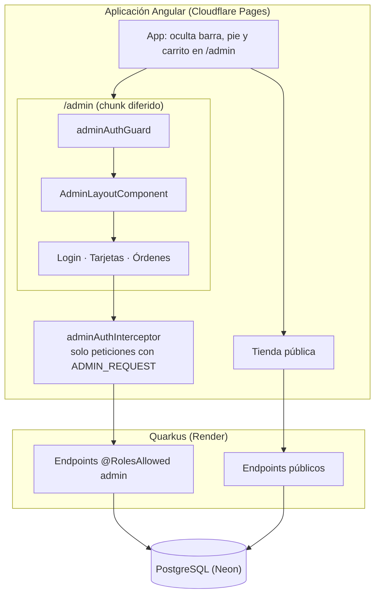
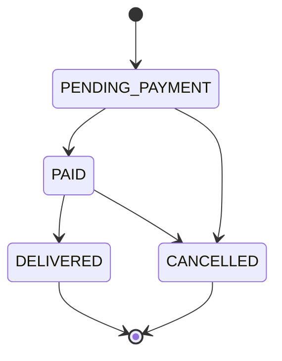

# Documento de Diseño: Panel Administrativo

## Overview

El Panel es una sección de la aplicación Angular existente (`/admin`), cargada en diferido, que consume el mismo backend Quarkus. No añade servicios externos ni librerías de interfaz. El backend solo se amplía donde la API actual no cubre el flujo.

### Qué falta en el código actual

| Hallazgo | Dónde | Cambio |
|---|---|---|
| El listado solo devuelve tarjetas activas | `TarjetaRepository.findActive` | Nuevo endpoint admin con activas e inactivas |
| No se puede reactivar una tarjeta | `TarjetaResource` | `PATCH /api/cards/{id}/activate` |
| El número de catálogo no puede pasar de 33 | `@Max(33)` en `TarjetaCreateRequest`, `CHECK` en V1 | Quitar `@Max` y migración `V3` |
| Máximo de 10 imágenes sin validar | `TarjetaCreateRequest`, `TarjetaUpdateRequest` | `@Size(max = 10)` |
| Se puede comprar una tarjeta inactiva | `OrderService` solo comprueba que exista | Rechazar con 404 si está inactiva |
| La ficha pública permite comprar una inactiva | `product-detail-page.component.ts` | Aviso y botón deshabilitado |
| Las órdenes tienen un solo estado | `OrderStatus` | Nuevos valores y transiciones |
| El detalle de orden no trae teléfono, entrega ni fecha | `OrderResponse` | Nuevo `OrderDetailDTO` solo para admin |
| El listado de órdenes no pagina y carga los ítems orden por orden | `OrderResource.listOrders` | Paginación y `@BatchSize` en `Orden.items` |
| Barra, pie y carrito se muestran en todas las rutas | `app.html` | Ocultarlos en `/admin` |
| El app shell de `index.html` pinta la cabecera de la tienda | `index.html` | El script también la retira en `/admin` |

---

## Decisiones

### Decisión 1: Imágenes por URL, sin subida de archivos

Render borra su disco en cada despliegue, y las fotos actuales viven en el repositorio y se publican con Cloudflare Pages. Subir archivos exigiría un almacenamiento externo, como Cloudflare R2, o guardar binarios en la capa gratuita de Neon.

En esta fase el formulario pide URLs. Una foto nueva se añade a `public/cards/` con un despliegue o se aloja en otro servicio. Esto limita la autonomía del Administrador al crear tarjetas, así que la subida es la primera candidata a la siguiente fase; `CardImage.url` no tendría que cambiar.

### Decisión 2: Se mantiene Basic Auth, con las credenciales en `sessionStorage`

Basic Auth ya está implementado y viaja por HTTPS. Pasar a JWT u OIDC añadiría dependencias, memoria y gestión de claves para un único usuario.

| Opción | Recargar la página | Riesgo ante XSS |
|---|---|---|
| Solo en memoria | Pide acceder otra vez | Menor |
| **`sessionStorage` (elegida)** | Mantiene la Sesión | Legible por scripts mientras la pestaña siga abierta |
| `localStorage` | Mantiene la Sesión | Persiste tras cerrar el navegador (descartada) |

El riesgo se acota porque la aplicación no carga scripts de terceros y Angular escapa los datos al renderizar. Los usuarios embebidos de Quarkus no limitan los intentos de acceso, de modo que la defensa frente a fuerza bruta es la longitud de `ADMIN_PASSWORD`. Render la genera con `generateValue`; antes de usar el Panel en producción conviene comprobar que no se ha sustituido por una corta.

### Decisión 3: El Panel vive en la misma aplicación

Un proyecto aparte supondría otro despliegue y otro origen en CORS, y duplicaría modelos y estilos. Con `loadChildren`, el código del Panel no se descarga en la tienda.

### Decisión 4: Sin librería de componentes

El proyecto usa Tailwind y componentes propios, y unos formularios y tablas no justifican el peso de otra dependencia.

---

## Architecture



---

## Components and Interfaces

### Rutas

| Ruta | Componente | Protegida |
|---|---|---|
| `/admin/login` | `AdminLoginComponent` | No |
| `/admin` | Redirige a `/admin/ordenes` | Sí |
| `/admin/ordenes` | `AdminOrdersPageComponent` | Sí |
| `/admin/ordenes/:orderCode` | `AdminOrderDetailComponent` | Sí |
| `/admin/tarjetas` | `AdminCardsPageComponent` | Sí |
| `/admin/tarjetas/nueva` | `AdminCardFormComponent` | Sí |
| `/admin/tarjetas/:id` | `AdminCardFormComponent` | Sí |

### Archivos del frontend (`src/app/admin/`)

| Archivo | Responsabilidad |
|---|---|
| `admin.routes.ts` | Rutas hijas, cargadas con `loadChildren` |
| `core/admin-auth.service.ts` | Signal de Sesión, `login`, `logout`, lectura de `sessionStorage` |
| `core/admin-auth.guard.ts` | Redirige a login conservando `returnUrl` |
| `core/admin-auth.interceptor.ts` | Añade `Authorization` y gestiona el 401 |
| `core/admin-card.service.ts` | Listado, alta, edición, activación y desactivación |
| `core/admin-order.service.ts` | Listado paginado, detalle y cambio de estado |
| `layout/admin-layout.component.ts` | Navegación del Panel y `router-outlet` |
| `shared/confirm-dialog.component.ts` | Diálogo con `<dialog>` nativo, que retiene el foco y cierra con Escape |
| `shared/order-status.ts` | Etiquetas de estado y transiciones permitidas |
| `login/`, `cards/`, `orders/` | Páginas |

### Autenticación en el frontend

- `ADMIN_REQUEST` es un `HttpContextToken<boolean>`. Solo los servicios del Panel lo activan.
- El interceptor añade la cabecera si el token está activo **y** la URL empieza por `${environment.apiUrl}/api/`. Se registra en `app.config.ts`, por lo que forma parte del bundle inicial; debe seguir siendo un archivo mínimo que no importe el resto del Panel.
- El usuario y la contraseña se codifican con `TextEncoder` antes de `btoa`, porque `btoa` falla con caracteres fuera de Latin-1.
- `returnUrl` solo se usa si empieza por `/admin/`, para evitar redirecciones abiertas.
- Ante un 401 en una petición con Sesión, se borra la Sesión y se navega a login. El 401 del propio login no cierra nada y se muestra como credenciales incorrectas.
- Las peticiones cross-origin usan `credentials: 'same-origin'`, así que el navegador no debería mostrar su diálogo nativo de Basic Auth pese a `WWW-Authenticate`. La tarea 1.5 lo verifica en un navegador real.

### Formulario de tarjeta

`AdminCardFormComponent` usa Reactive Forms, como el checkout, con un `FormArray` de imágenes. El fallo de la vista previa se detecta con el evento `error` del `` y solo produce un aviso. Un guard `canDeactivate` pide confirmación si hay cambios sin guardar.

### App y app shell

`App` deriva un signal `isAdmin` de los eventos `NavigationEnd` y de la URL inicial, y envuelve en `@if (!isAdmin())` la barra, el pie y el carrito. El script de `index.html` retira el shell completo si la ruta empieza por `/admin`, para que no parpadee la cabecera de la tienda.

---

## Data Models

### Migración `V3__numero_catalogo_sin_tope.sql`

```sql
ALTER TABLE tarjeta DROP CONSTRAINT chk_catalog_number_range;
ALTER TABLE tarjeta ADD CONSTRAINT chk_catalog_number_positive CHECK (catalog_number >= 1);
```

El estado de la Orden es `VARCHAR(30)` sin `CHECK`, así que los nuevos valores del enum no requieren migración. Las Órdenes existentes, incluida la de prueba `ORD-2026-0001`, siguen válidas en `PENDING_PAYMENT` y pueden cancelarse desde el Panel.

### Máquina de estados



La regla vive en `OrderStatus.canTransitionTo(OrderStatus)`. El frontend replica la tabla solo para decidir qué botones mostrar; la autoridad es el backend.

---

## Contratos REST

Todos los endpoints nuevos requieren el rol `admin`. Los errores usan el `ErrorResponse` existente.

### `GET /api/admin/session`
`200 { "username": "admin" }` o `401`.

### `GET /api/admin/cards`
`200` con un arreglo, ordenado por número de catálogo, de `{ id, catalogNumber, name, categories, price, coverImageUrl, active }`. No se pagina porque el catálogo es pequeño y los filtros son locales. Las imágenes se inicializan dentro de la transacción, como en `TarjetaService.findAll`.

### `PATCH /api/cards/{id}/activate`
`200 { id, active: true, message }` o `404`.

### `GET /api/orders?status=&page=0&size=20`
Cambia de arreglo a respuesta paginada. El frontend todavía no consume este endpoint, de modo que el cambio no rompe nada.

```json
{
  "content": [{ "orderCode": "ORD-2026-0001", "customerName": "…", "totalAmount": 20.00, "status": "PENDING_PAYMENT", "createdAt": "…" }],
  "page": 0, "size": 20, "totalElements": 1, "totalPages": 1
}
```

`size` se limita a 100. Un `status` inexistente devuelve `400`.

### `GET /api/orders/{orderCode}`
Devuelve `OrderDetailDTO`: los campos de `OrderResponse` más `customerPhone`, `deliveryAddress` y `estimatedDeliveryDate`. `POST /api/orders` sigue devolviendo `OrderResponse` sin cambios.

### `PATCH /api/orders/{orderCode}/status`
Cuerpo `{ "status": "PAID" }`. Responde `200` con `OrderDetailDTO`, `404` si no existe, `409` si la transición no está permitida y `422` si falta el estado.

### Cambios en endpoints existentes
- `POST /api/cards`: sin tope superior de número de catálogo.
- `POST /api/cards` y `PUT /api/cards/{id}`: `@Size(max = 10)` en `images`.
- `POST /api/orders`: `404` si alguna Tarjeta está inactiva. El mensaje del checkout para el 404 ya dice que la tarjeta no está disponible.

---

## Correctness Properties

La numeración continúa la del spec base.

### Property 8: Solo transiciones permitidas
*Para todo* par de estados (a, b), `a.canTransitionTo(b)` es verdadero únicamente para los cuatro pares del criterio 12.4, y un cambio no permitido deja la Orden intacta.

**Validates: Requirements 12.4, 12.5**

### Property 9: Las órdenes conservan su historia
*Para toda* Orden y toda edición o desactivación de sus Tarjetas, el nombre, el precio unitario y el total de la Orden no cambian.

**Validates: Requirements 11.15**

### Property 10: Ida y vuelta de activación
*Para toda* Tarjeta, desactivarla y activarla la devuelve al catálogo público con los mismos datos e imágenes.

**Validates: Requirements 11.11, 11.12**

### Property 11: Las credenciales no salen del Panel
*Para toda* URL y valor de `ADMIN_REQUEST`, el interceptor añade `Authorization` solo si el token está activo y la URL pertenece a la API.

**Validates: Requirements 10.9**

### Property 12: Credenciales con cualquier carácter
*Para todo* usuario y contraseña Unicode, decodificar la cabecera generada devuelve los valores originales.

**Validates: Requirements 10.1**

---

## Error Handling

| Situación | Comportamiento en el Panel |
|---|---|
| Red o servidor despertando | Mensaje con botón "Reintentar"; el formulario conserva lo escrito |
| 401 en una petición con Sesión | Cierra la Sesión y vuelve a login con mensaje |
| 404 al abrir tarjeta u orden | "No encontrada" con enlace al listado |
| 409 por número de catálogo | Error junto al campo |
| 409 por estado de orden | Mensaje y recarga de la Orden |
| 422 | Mensaje del backend en el formulario |

---

## Testing Strategy

- **Backend (JUnit, RestAssured, jqwik):** 401 sin credenciales en cada endpoint nuevo, transiciones (Property 8), historia de órdenes (Property 9), activación (Property 10), migración V3 con el número 34, compra de tarjeta inactiva y `status` inválido.
- **Frontend (Jest, fast-check):** servicio de autenticación, guard, interceptor (Properties 11 y 12), formulario de tarjeta, acciones por estado y ocultación de la barra en `/admin`.
- **Manual:** flujo completo a 375 px y en escritorio, teclado, y Lighthouse de la portada tras el despliegue.
